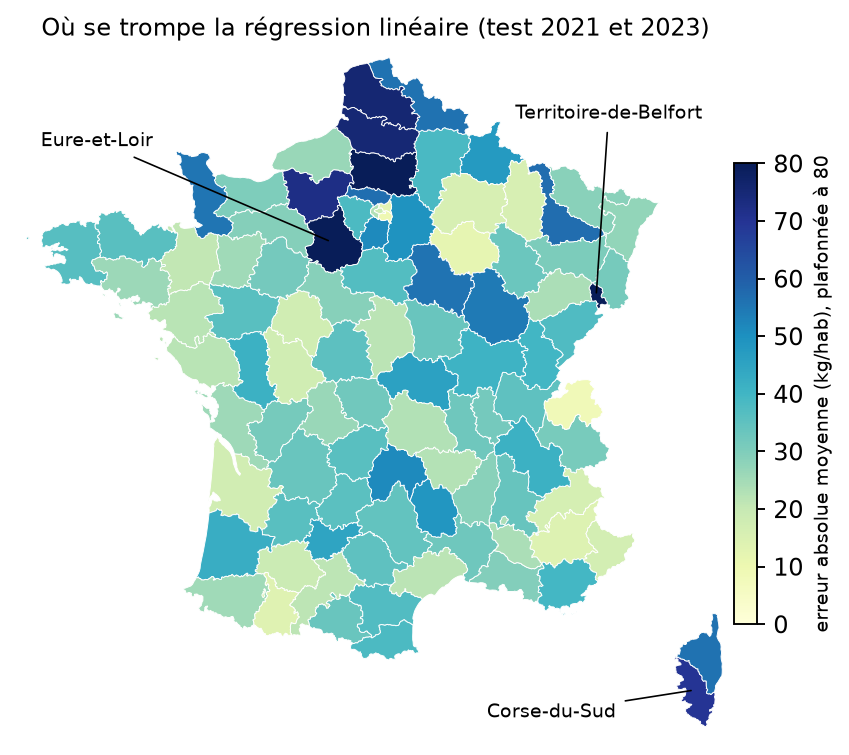
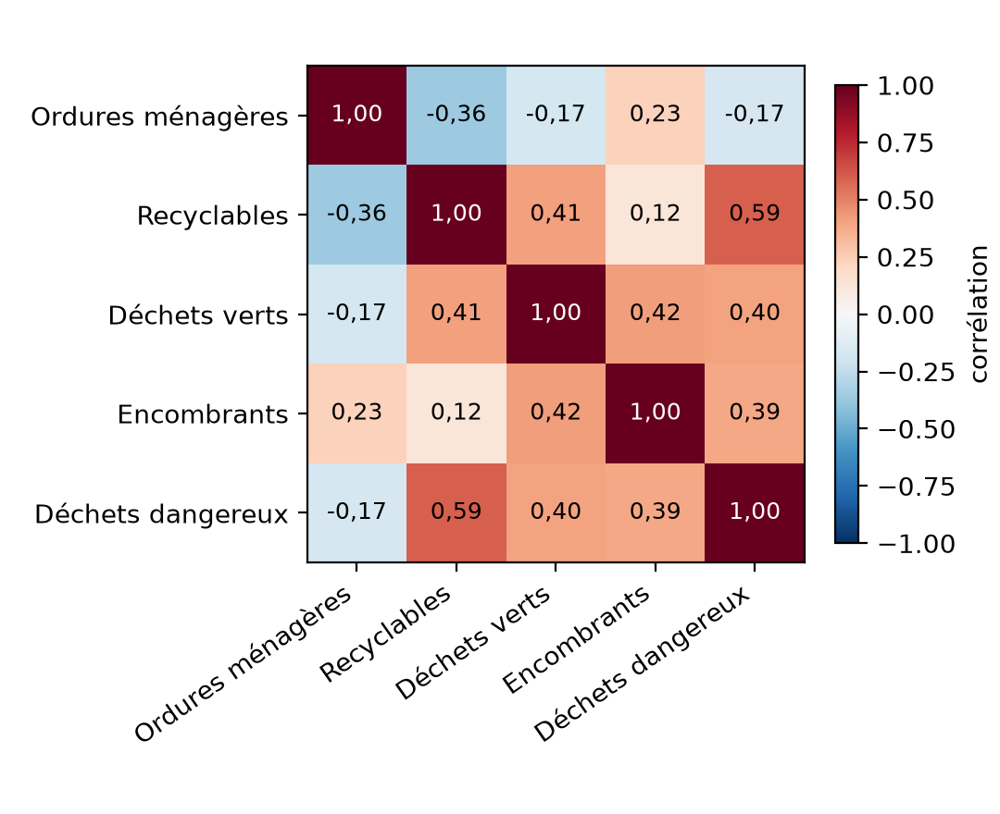
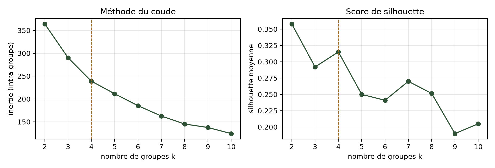
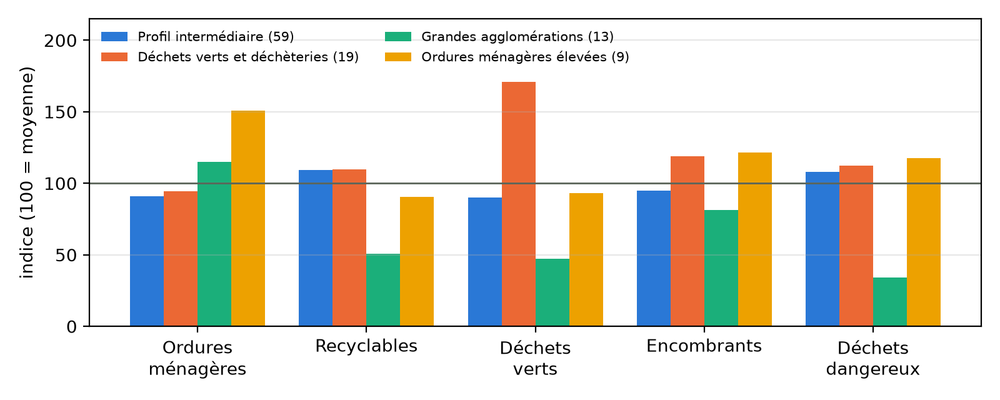
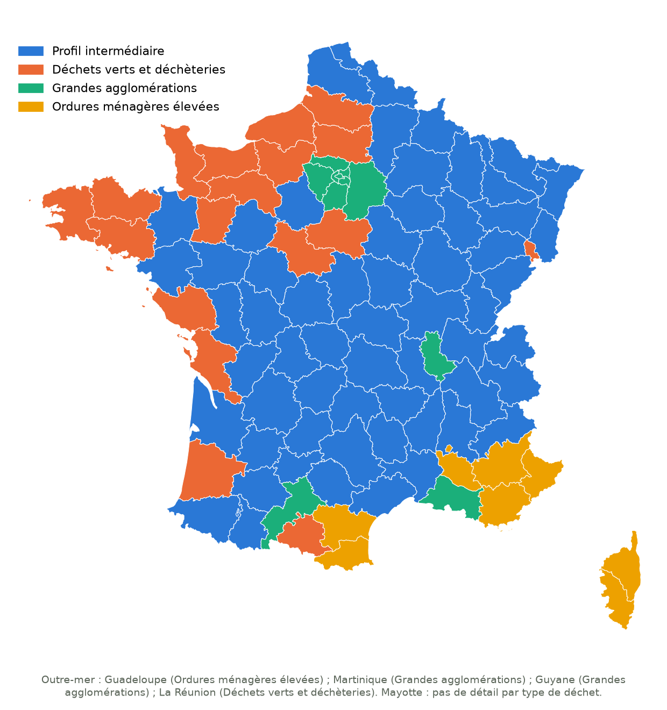
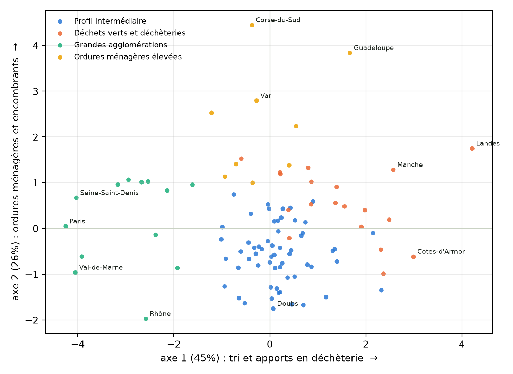
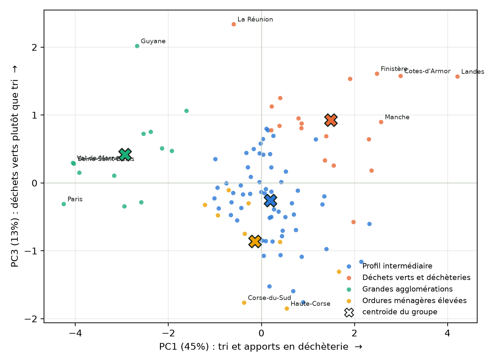
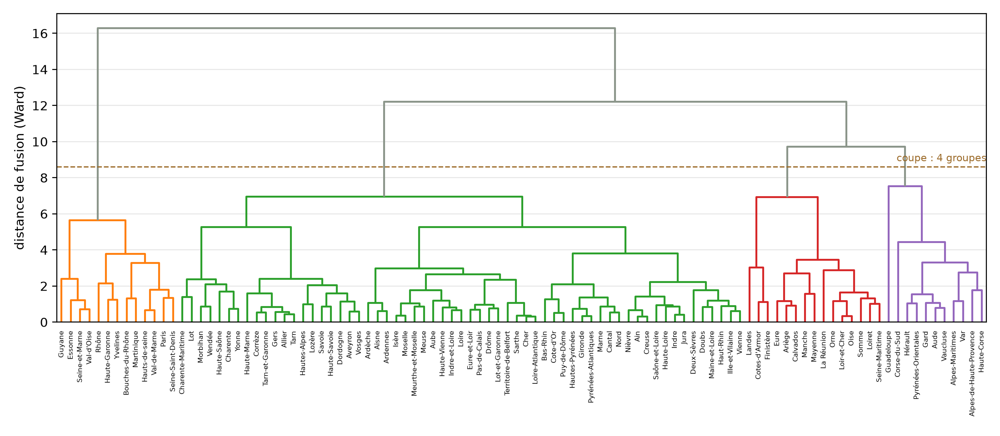
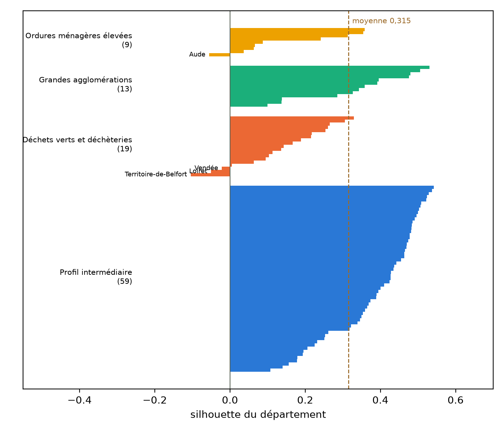

<!-- _class: title -->
<!-- _paginate: false -->

DATA SCIENCE & MACHINE LEARNING · PROJET FIL ROUGE

# Les déchets des départements français

Prédire la production par habitant (supervisé), puis identifier des profils de départements (non supervisé)

ALVES Rudy · ANTHONY Josselin · BENASSIE Noé · TAVERNIER Florian iRUP Alternance · Données publiques ADEME et INSEE · github.com/Rxdy/ML-DMA

<!-- Durée totale : 30 minutes. Partie 1 : 4 min, partie 2 : 5 min (rappel), partie 3 : 16 min, partie 4 : 5 min. -->

---

# Déroulé : 30 minutes

| Partie | Contenu | Durée |
|---|---|---|
| 1. Explorer | Les données, le thème, ce qu'on peut en faire | 4 min |
| 2. Prédire et évaluer | Rappel : X et Y, modèles, performance, géolocalisation des erreurs | 5 min |
| 3. Segmenter | K-means, choix des variables, interprétation des clusters | 16 min |
| 4. Conclusions | Prise de recul, limites, pistes d'amélioration | 5 min |

<!-- La partie 2 a déjà été présentée avec son rapport PDF : on la reprend en rappel. Insister sur le fait que la partie 3 est le cœur de cette présentation. -->

---

<!-- _class: part -->

# Partie 1
## Explorer : les données et leur thème
4 minutes

---

# Le thème : qu'est-ce qu'on peut faire de ces données ?

Chaque département produit des déchets ménagers et assimilés (DMA) : ordures ménagères, recyclables, déchets verts, encombrants, déchets dangereux. L'ADEME les recense (base SINOE), l'INSEE fournit la population et le revenu.

<b>Prédire</b> Quelle quantité par habitant à la prochaine enquête ? Apprentissage supervisé : une réponse connue sert d'exemple.

<b>Segmenter</b> Les départements se ressemblent-ils par ce qu'ils jettent ? Non supervisé : aucune réponse attendue.

<b>Décider</b> Savoir où l'on se situe pour adapter collecte, tri et compostage.

<!-- Poser les deux questions de nature différente qui structurent tout le projet. -->

---

# Quatre sources publiques

| Fichier | Producteur | Lignes | Période | Rôle |
|---|---|---|---|---|
| sinoe_dma | ADEME (SINOE) | 14 660 | 2009–2021 | Tonnage par déchet et traitement |
| sinoe_chiffres_cles_hors_gravats | ADEME (SINOE) | 800 | 2009–2023 | Base de la régression |
| sinoe_chiffres_cles_avec_gravats | ADEME (SINOE) | 701 | 2009–2021 | Contrôle des populations, écarté |
| insee_revenu_median_dep | INSEE (Filosofi) | 491 | 2013–2021 | Test du revenu médian |

Licence Ouverte 2.0 (data.gouv.fr). Fichiers bruts inclus dans le dépôt : tout se rejoue sans téléchargement.

---

# Exploration : qualité des données et périmètre

- **Aucune valeur manquante, aucun doublon** (lignes identiques et clés répétées vérifiées)
- **Enquête biennale** : années impaires seulement, ce n'est pas un trou à combler
- **Gravats exclus** : ils viennent des chantiers, pas des ménages. Écart-type du ratio : 100,6 kg/hab avec gravats, **80,3 sans**
- **Cible = ratio kg/habitant** : le tonnage est corrélé à 97 % avec la population, le prédire reviendrait à réapprendre une multiplication

<!-- Chaque choix répond à un constat de l'exploration. -->

---

<!-- _class: part -->

# Partie 2
## Rappel : prédire et évaluer
5 minutes — déjà présentée, détail dans le rapport supervisé

---

# Le problème : X et Y, et un test honnête

**Question :** peut-on prédire le ratio de déchets par habitant d'un département à la prochaine enquête ?

| Rôle | Variables |
|---|---|
| **Y** (cible) | ratio DMA en kg/habitant |
| **X** | ratio et tonnage de l'enquête précédente, population, profil de traitement (cluster) |

- **Découpage dans le temps** : entraînement 2011–2019 (501 lignes), test 2021 et 2023 (198 lignes)
- **Pipeline** (MinMaxScaler, OneHotEncoder) calibrée sur l'entraînement seul : pas de fuite de données

---

<!-- _class: num -->

# Résultat : aucun modèle ne bat la règle naïve

| Modèle (test 2021–2023) | MAE kg/hab | RMSE | R² |
|---|---|---|---|
| Baseline moyenne | 61,99 | 82,14 | −0,010 |
| Baseline naïve (enquête précédente) | 36,49 | 44,58 | 0,702 |
| **Régression linéaire** | **35,75** | **43,53** | **0,716** |
| Arbre de décision | 37,04 | 45,58 | 0,689 |
| Random Forest | 36,08 | 44,36 | 0,705 |

Gain sur la règle naïve : **0,74 kg/hab, soit 2 % de l'erreur**. La valeur précédente porte **94,9 %** de l'importance des variables.

<!-- Ce n'est pas un échec : la production par habitant change très peu d'une enquête à l'autre. Les variables comme la population ne varient pas dans le temps, elles ne peuvent pas expliquer un changement. -->

---

# Où le modèle se trompe : la géographie des erreurs

- Les erreurs ne sont pas réparties au hasard
- **Corse : +51,8 kg/hab** de surestimation moyenne (10 à 15 pour la plupart des régions)
- Hypothèse : les touristes ne sont pas comptés dans la population résidente
- **Eure-et-Loir** et **Territoire-de-Belfort** se distinguent aussi : on y revient en conclusion

---

<!-- _class: part -->

# Partie 3
## Segmenter : les profils de départements
16 minutes

---

# Une autre question

En supervisé : une réponse connue à prédire.
Ici : **aucune réponse**, on cherche des groupes qui se ressemblent.

> **Existe-t-il des profils types de départements selon la façon dont leurs habitants jettent leurs déchets ?**

Le clustering regroupe sur les variables qu'on lui donne : **choisir les variables, c'est décider de ce que « se ressembler » veut dire.**

<!-- Transition : de « prédire » à « découvrir ». -->

---

<!-- _class: num -->

# Choix des variables : 5 flux de production

| Variable (kg/habitant) | Moyenne | Min | Max |
|---|---|---|---|
| Ordures ménagères résiduelles (OMR) | 239 | 135 | 459 |
| Matériaux recyclables | 132 | 21 | 201 |
| Déchets verts et biodéchets | 88 | 1 | 280 |
| Encombrants | 78 | 35 | 122 |
| Déchets dangereux | 10 | 0,2 | 28 |

- **Production retenue**, traitement écarté : déchets verts et compostage corrélés à 0,71, ce serait compter deux fois la même chose
- **Écartés** : gravats, « autres », total (somme des autres)
- **Gardés pour interpréter** : population, revenu, traitement

---

# Préparer : kg par habitant et standardisation

- **kg/habitant, pas tonnes** : pour comparer Paris et la Lozère
- **Une ligne par département** : moyenne des enquêtes 2019 et 2021 → **100 départements** (Mayotte sans détail)
- **Standardisation** (moyenne 0, écart-type 1) : sans elle, les OMR (~240 kg) pèseraient **24 fois** plus que les déchets dangereux (~10 kg) dans les distances

<!-- Les variables ne se répètent pas : aucune corrélation ne dépasse 0,6. Recyclables/dangereux 0,59 ; OMR/recyclables -0,36 : ce qui n'est pas trié finit dans la poubelle ordinaire. -->

---

# K-means : comment ça marche

1. **Initialisation** : k centres tirés au hasard
2. **Affectation** : chaque département rejoint le centre le plus proche
3. **Mise à jour** : chaque centre devient la moyenne de son groupe
4. **Itération** jusqu'à stabilité

- **Distance euclidienne** (ligne droite) : d'où la standardisation
- **Inertie (WCSS)** : somme des distances² aux centres. Faible = groupes compacts

| Limite | Ce que nous avons fait |
|---|---|
| Choisir k à l'avance | Coude + silhouette, puis dendrogramme |
| Dépend du départ aléatoire | 20 lancements, graine fixe, stabilité testée sur 10 autres graines |
| Groupes « arrondis » | Standardisation, DBSCAN en comparaison |

---

# Combien de groupes ? Coude et silhouette

- **Inertie** : baisse toujours, on cherche le coude
- **Silhouette** (−1 à 1) : proche de 1, le département est bien placé ; négatif, il serait mieux ailleurs

---

<!-- _class: num -->

# Décision : k = 4

| k | Inertie | Baisse | Silhouette | Plus petit groupe |
|---|---|---|---|---|
| 2 | 364 | — | 0,358 | 21 |
| 3 | 290 | −20 % | 0,292 | 13 |
| **4** | **239** | **−18 %** | **0,315** | **9** |
| 5 | 211 | −12 % | 0,250 | 10 |
| 6 | 185 | −12 % | 0,241 | 1 |

- **Coude à 4** et pic local de silhouette
- k = 2 : meilleure silhouette mais trop grossier (grandes villes + Méditerranée / reste)
- **k ≥ 6** : un groupe réduit à la Guadeloupe, un cas extrême, pas un profil

---

<!-- _class: num -->

# Les 4 profils

| Groupe | Dép. | OMR | Recycl. | Verts | Encomb. | Dang. | Total |
|---|---|---|---|---|---|---|---|
| Profil intermédiaire | 59 | 217 | 144 | 80 | 74 | 11 | 528 |
| Déchets verts et déchèteries | 19 | 226 | 145 | 151 | 93 | 12 | 629 |
| Grandes agglomérations | 13 | 275 | 67 | 42 | 64 | 3 | 456 |
| Ordures ménagères élevées | 9 | 361 | 120 | 82 | 95 | 12 | 674 |

---

# Une géographie retrouvée sans donnée géographique

Le modèle n'a reçu **que des kilos de déchets** : ni région, ni coordonnées.

Les groupes dessinent pourtant :
- le **Grand Ouest**
- les **grandes agglomérations**
- la **Méditerranée et la Corse**
- une **France intermédiaire**

---

<!-- _class: bigbox -->

# Interpréter les groupes

<b>Profil intermédiaire (59)</b> France « moyenne » : Centre, Est, Massif central. Le plus cohérent (silhouette 0,39).

<b>Déchets verts et déchèteries (19)</b> Grand Ouest. Verts ×1,7 (151 kg/hab). Compostent le plus (22 %). Hypothèse : maisons avec jardin.

<b>Grandes agglomérations (13)</b> Île-de-France, Lyon, Marseille, Toulouse. Le moins de déchets (456) mais le moins de tri. Incinèrent le plus (49 %).

<b>Ordures ménagères élevées (9)</b> Méditerranée et Corse. OMR ×1,5 (361 ; 459 en Corse-du-Sud). Stockage 37 %. Hypothèse : tourisme.

<!-- Les explications (jardins, habitat collectif, tourisme) sont des hypothèses : nos données ne permettent pas de les vérifier. La Martinique et la Guyane rejoignent les agglomérations pour une autre raison : le nom décrit la majorité des membres. -->

---

<!-- _class: num -->

# On confronte aux variables non utilisées

| Groupe | Population | Revenu médian | Incinération | Stockage | Valorisation organique |
|---|---|---|---|---|---|
| Profil intermédiaire | 562 000 | 21 900 € | 21 % | 22 % | 15 % |
| Déchets verts et déchèteries | 592 000 | 21 700 € | 21 % | 18 % | **22 %** |
| Grandes agglomérations | **1 407 000** | **23 000 €** | **49 %** | 16 % | 9 % |
| Ordures ménagères élevées | 500 000 | **20 700 €** | 20 % | **37 %** | 11 % |

Ces variables **n'ont pas servi** à former les groupes : on évite le raisonnement circulaire. Le traitement suit la production : les groupes qui collectent des déchets verts les compostent.

---

<!-- _class: num -->

# La PCA : réduire de 5 à 3 dimensions

| Composante | Valeur propre | Variance | Cumul |
|---|---|---|---|
| PC1 | 2,27 | 44,9 % | 44,9 % |
| PC2 | 1,33 | 26,3 % | 71,3 % |
| **PC3** | 0,67 | 13,2 % | **84,4 %** |
| PC4 | 0,47 | 9,2 % | 93,7 % |

- **3 composantes** : coude de l'éboulis et règle des 80–90 % (84 %)
- **PC1** : le tri et les apports en déchèterie, face à la poubelle ordinaire
- **PC2** : le volume d'ordures ménagères et d'encombrants
- **PC3** : les déchets verts, face au tri des emballages et dangereux

---

# Les groupes sur les axes de la PCA

Chaque groupe occupe sa zone : agglomérations à gauche (peu de tri), Ouest à droite, Méditerranée en haut. **Les groupes ne sont pas un artefact du k-means.**

---

<!-- _class: num -->

# Les groupes sont-ils solides ?

| Essai | ARI avec nos 4 groupes | Silhouette |
|---|---|---|
| k-means, 10 autres graines | 0,81 à 1,00 | 0,312 à 0,319 |
| Clustering hiérarchique (Ward) | 0,82 | 0,315 |
| k-means sans l'outre-mer | 0,65 | 0,291 |
| Clustering du traitement (supervisé) | 0,006 | — |

- **Stables** d'une graine à l'autre : seule la frontière « déchets verts » bouge
- Sans l'outre-mer : les **cœurs** restent, les **frontières** se déplacent
- ARI 0,006 : production et traitement sont **indépendants**, ils ne devaient pas être mélangés

ARI : 1 = mêmes groupes, 0 = pas mieux que le hasard.

---

# Deux autres méthodes : hiérarchique et DBSCAN

**Clustering hiérarchique (Ward)**
Grands sauts de hauteur jusqu'à 4 groupes (4,07 → 2,50 → 2,19), puis effondrement (0,58 → 0,02) : **4 est la coupe la plus fine qui ait un sens.**

**DBSCAN** (MinPts = 10, ε = 2,53)
**Un seul groupe dense** et 2 points de bruit : **Landes** et **Guadeloupe**. Les départements forment un **continuum**, pas des îlots.

---

# Où les groupes sont fragiles

- Cohérents : intermédiaire (**0,39**) et agglomérations (**0,34**)
- Fragiles : déchets verts (**0,14**) et OMR élevées (**0,16**)
- **4 cas frontières** (silhouette négative) : Aude, Loiret, Vendée, Territoire-de-Belfort

À ne pas sur-interpréter.

---

<!-- _class: part -->

# Partie 4
## Prise de recul : conclusions, limites, pistes
5 minutes

---

# Ce qu'il faut retenir

- **Supervisé** : prédire revient presque à recopier l'enquête précédente (R² 0,716 contre 0,702)
- **Non supervisé** : **4 profils** de départements, géographiques, retrouvés sans coordonnées
- Deux facteurs semblent structurer la carte : **le type d'habitat** et **le tourisme** (hypothèses)
- Les profils expliquent **pourquoi** les niveaux diffèrent durablement ; la prédiction montre que ces niveaux **bougent peu**
- **Aucun profil n'est « meilleur »** : les agglomérations produisent le moins mais trient le moins ; l'Ouest produit beaucoup mais composte

---

# Ce qui manque au modèle : une information nationale

| | 2021 | 2023 |
|---|---|---|
| Évolution moyenne des départements | +21,5 kg/hab | −43,8 kg/hab |
| Départements en baisse | 11 % | 97 % |
| Erreur du modèle | −22 | +43 |

Tous les départements se trompent **dans le même sens** : l'erreur est **commune**, pas locale. Il manque une valeur **nationale qui change d'une année à l'autre** (inflation, pouvoir d'achat, consommation).

Si on connaissait l'évolution nationale : **MAE 36,5 → 19,9, R² 0,70 → 0,88** (plafond théorique, inconnue à l'avance).

---

<!-- _class: num -->

# Hypothèse et cas à vérifier

**Hypothèse : le pouvoir d'achat.** Les prix ont fortement augmenté en 2022–2023 : moins d'achats, moins de déchets, partout. Non vérifiable avec nos données : le revenu médian INSEE s'arrête en 2021 et ignore les prix.

**Eure-et-Loir et Territoire-de-Belfort** : les plus grosses erreurs (123 et 110 kg/hab).

| Ratio (kg/hab) | 2019 | 2021 | 2023 |
|---|---|---|---|
| Eure-et-Loir | 513 | 609 | 454 |
| Territoire-de-Belfort | 502 | 603 | 479 |
| Oise (comparaison) | 559 | 607 | 492 |

Ces deux séries s'écartent plus que les autres, **sans preuve d'erreur** : à vérifier à la source.

---

# Limites

**Supervisé**

- 8 enquêtes seulement, une tous les 2 ans
- Variables trop stables pour expliquer un changement
- Rupture 2021–2023 de cause inconnue : Covid, consignes de tri, pouvoir d'achat sont des **hypothèses**
- Périmètres légèrement différents : gravats inclus dans le clustering de traitement, exclus de la cible

**Non supervisé**

- Structure modérée (silhouette 0,315) : un seul nuage pour DBSCAN
- 2 groupes fragiles, 4 départements frontières
- Sensible aux valeurs extrêmes et à l'outre-mer (ARI 0,65 sans)
- Une photo 2019–2021, pas un film
- Explications (habitat, tourisme) = **hypothèses**

---

# Pistes d'amélioration

<b>Dans le temps</b> Données <b>mensuelles</b> : 12 points par an, ruptures et saisonnalité touristique.

<b>Dans l'espace</b> Données <b>par ville</b> : lien avec la taille de la ville, écarts au sein d'un département.

<b>Par zone</b> Chaque ville rattachée à sa zone et son département : on retrouve le compte rendu départemental.

&nbsp;

**Le prix à payer :** ces données n'existent pas dans les bases publiques. Il faut davantage de moyens (recueil mensuel auprès de chaque collectivité, format commun). Bénéfice : meilleure gestion des déchets et vue sur les écarts entre territoires.

&nbsp;

**Piste prioritaire :** ajouter une série nationale (inflation, pouvoir d'achat). **Ensuite :** variables INSEE logement et tourisme, tarification incitative.

---

<!-- _class: title -->
<!-- _paginate: false -->

# Merci de votre attention

Aucun profil n'est exemplaire : chaque territoire appelle une stratégie adaptée à son habitat et à sa démographie.

`git clone https://github.com/Rxdy/ML-DMA.git && make installer && make all`

Questions et discussion · ALVES Rudy · ANTHONY Josselin · BENASSIE Noé · TAVERNIER Florian

